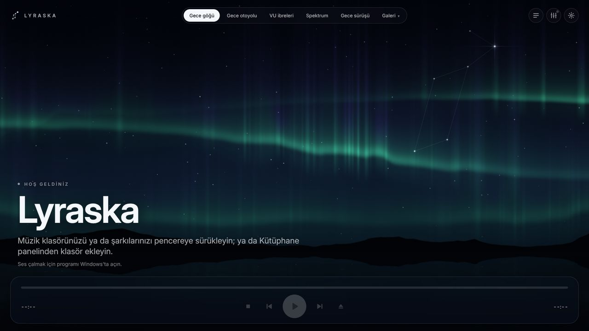
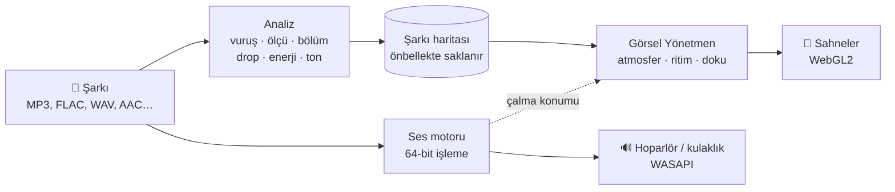
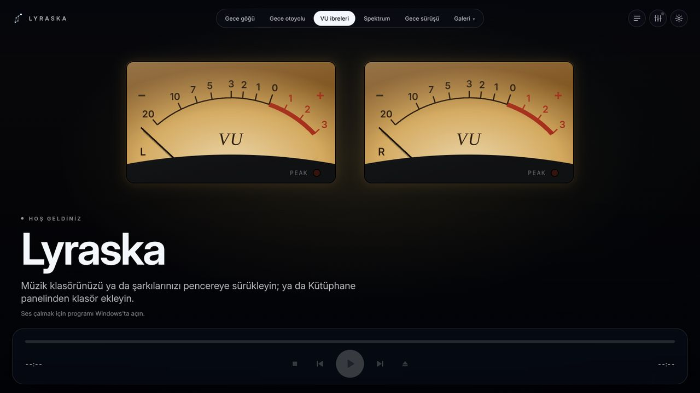
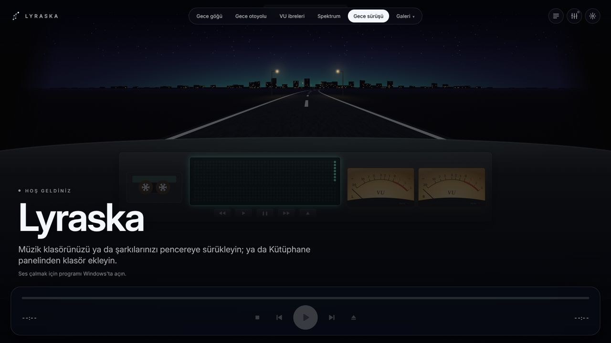
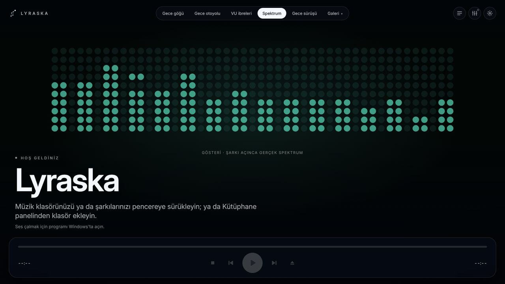
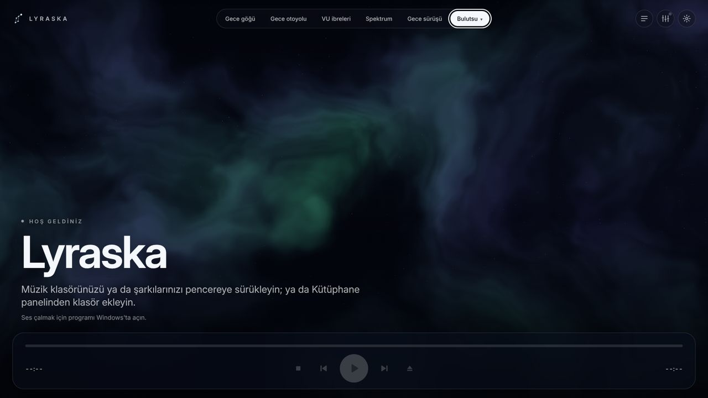
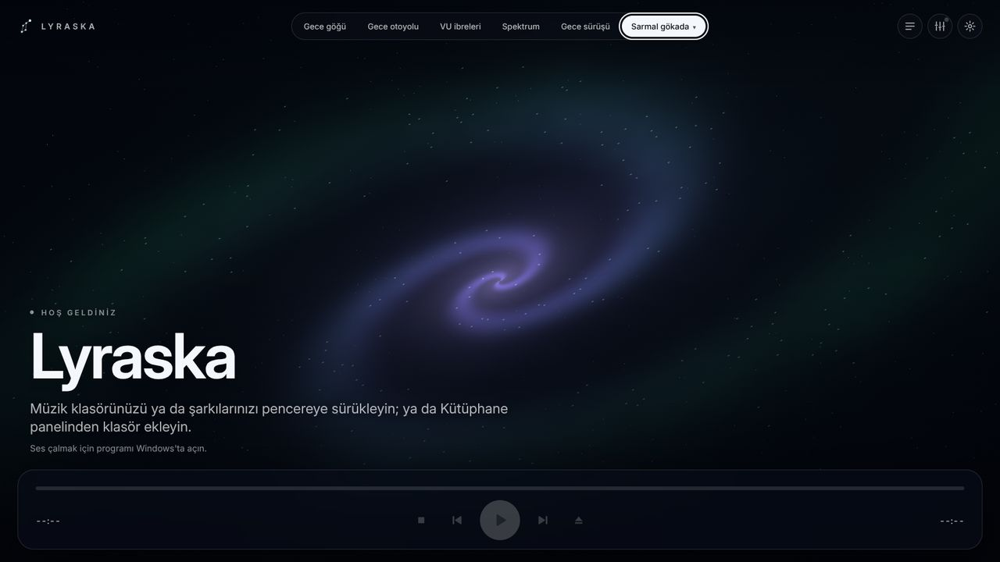
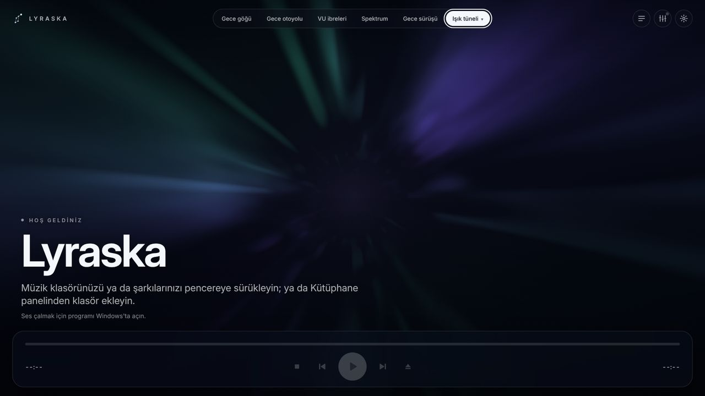
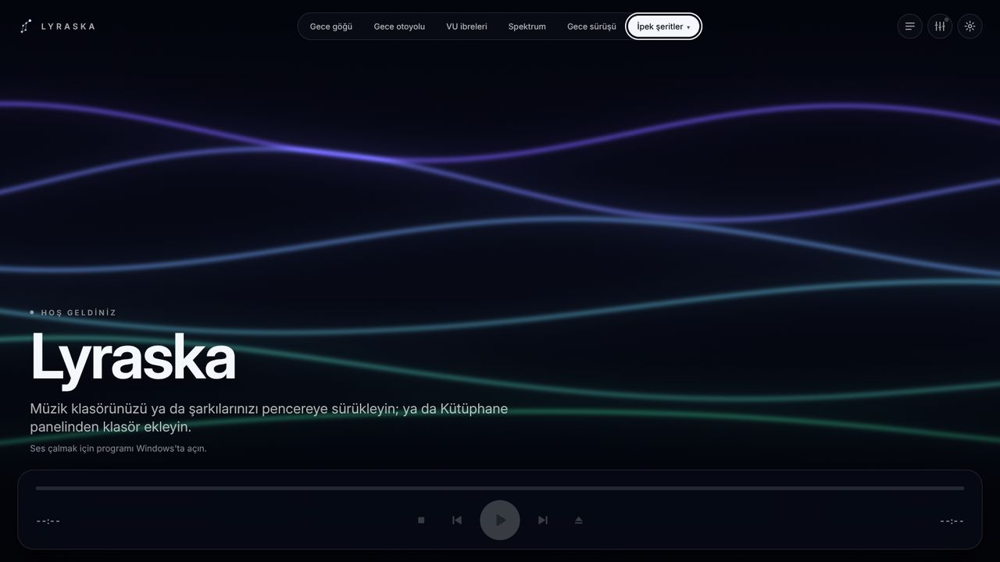

<div align="center">

# Lyraska

**Şarkıyı çalmadan önce tanıyan, tamamen çevrimdışı bir Windows müzik çalar.**

Adını lir çalgısından (_lyre_) ve Lyra takımyıldızından alır.

[**⬇ Windows için indir (test sürümü)**](https://github.com/lahmacunveayran/Lyraska/releases/download/test-surumu/Lyraska-Kurulum.exe)
· [Yol haritası](docs/ROADMAP.md) · [Hata bildir](https://github.com/lahmacunveayran/Lyraska/issues/new/choose)



</div>

> **Erken geliştirme (1.0, 7. faz bittikten sonra).** [Yol haritasının](docs/ROADMAP.md) 1–3. fazları (çalan
> program, Görsel Yönetmen, profesyonel ses) tamam; 4. faz (görsel kütüphane, kütüphane, şarkı sözleri) sürüyor.
> Test sürümleri sürekli yayımlanır; bkz. **İndir**.

## Nasıl çalışır?

Çoğu müzik görselleştiricisi sese **o anda** tepki verir. Lyraska ise her şarkıyı çalmadan önce dinler: vuruşları,
ölçüleri, bölümleri, drop'ları, enerjiyi ve tonu çıkarıp bir **şarkı haritası** hazırlar. **Görsel Yönetmen** bu
haritayla görselleri üç katmanda koreografe eder (**atmosfer**, **ritim**, **doku**). Böylece sahneler müziğin
peşinden koşmaz, drop gelmeden onu bekler.



## Sahneler

Beş klasik sahne, sekiz sahnelik bir galeri, kendi resminizle "Kendi resmin" ve kendi `.milk` dosyalarınızla MilkDrop. Sahneler arasında **1–9, 0**
ve **PageUp / PageDown** tuşlarıyla geçilir.

|                                                   |                                                       |
| :-----------------------------------------------: | :---------------------------------------------------: |
|        |            |
| **VU ibreleri:** özgün tasarım analog göstergeler | **Gece sürüşü:** eski araba teybi havası, özgün çizim |
|              |                    |
|   **Spektrum:** nokta vuruşlu frekans çubukları   |                 **Bulutsu** (galeri)                  |
|    |            |
|            **Sarmal gökada** (galeri)             |               **Işık tüneli** (galeri)                |
|    |                                                       |
|            **İpek şeritler** (galeri)             |                                                       |

<sub>Görüntüler arayüzün tarayıcı önizlemesinden, şarkı çalmazken alındı. Gerçek programda sahneler müzikle
birlikte hareket eder.</sub>

## Öne çıkanlar

- 🔒 **Tamamen çevrimdışı:** hesap yok, telemetri yok, internet gerekmez.
- 🎬 **Şarkıyı bilen görseller:** önceden yapılan analizle yönetilen WebGL2 sahneleri; ses ile görüntü arasında
  ±20 ms hedefli gecikme telafisi; kendi `.lrc` dosyanızdan ya da şarkıya gömülü sözlerden zamanlı şarkı sözleri.
- 📻 **Nostalji modları:** eski araba teyplerinden ve VU göstergelerinden esinlenen **özgün** tasarımlar. Hiçbir
  markanın adı ya da varlığı kullanılmaz.
- 🛡️ **Işığa duyarlılık için güvenli:** hiçbir sahne saniyede üç kereden fazla parlamaz; güvenli mod bunu saniyede
  bire indirir; Windows'taki "animasyonları azalt" tercihine uyulur.
- 🎧 **Profesyonel ses:** 64-bit iç işleme, WASAPI çıkışı, parametrik EQ, AutoEq kulaklık profilleri, EBU R128 ses
  yüksekliği eşitleme, crossfeed, bit-perfect mod ve kör dinleme testi (ABX).

## İndir

Windows kurulum dosyasının en son test sürümü hep aynı adreste:

**<https://github.com/lahmacunveayran/Lyraska/releases/download/test-surumu/Lyraska-Kurulum.exe>**

`main` her değiştiğinde ve CI geçtiğinde kendiliğinden yeniden derlenir. Kurulum dosyası kod imzalı değildir; bu
yüzden Windows SmartScreen "tanınmayan yayımcı" uyarısı gösterir: **Ek bilgi → Yine de çalıştır**'a basın. Her
sürüm bir GitHub derleme kaynağı belgesi (build provenance attestation) taşır; dosyanın bu depodan derlendiğini
şöyle denetleyebilirsiniz:

```sh
gh attestation verify Lyraska-Kurulum.exe --repo lahmacunveayran/Lyraska \
  --signer-workflow lahmacunveayran/Lyraska/.github/workflows/test-surumu.yml \
  --source-ref refs/heads/main
```

Program, Windows 10/11'de zaten bulunan Microsoft Edge WebView2'ye ihtiyaç duyar. Yoksa kurulum dosyası onu bir
kez indirir; oynatıcının kendisi hiçbir zaman internete bağlanmaz.

Veriler, program kimliğiyle adlandırılmış iki klasörde durur (var olan veriler kaybolmasın diye kimlik projenin
eski hesap adını korur):

- `%APPDATA%\io.github.gozlemesevdalisi.lyraska`: ayarlar, vuruş/drop işaretleriniz ve içe aktarılan şarkı
  haritaları. Küçüktür ve **yeniden üretilemez**: silinirse işaretleriniz kaybolur.
- `%LOCALAPPDATA%\io.github.gozlemesevdalisi.lyraska`: analiz önbelleğiyle birlikte kütüphane veritabanı ve
  günlükler. Silmek güvenlidir, ama müzik klasörlerinizi yeniden eklemeniz gerekir ve her şarkı yeniden analiz
  edilir.

## Teknoloji

| Alan      | Teknoloji                                               |
| --------- | ------------------------------------------------------- |
| Uygulama  | [Tauri 2](https://tauri.app)                            |
| Ses       | Rust: `symphonia` (çözme), `wasapi` (çıkış), 64-bit DSP |
| Analiz    | Rust                                                    |
| Arayüz    | React + TypeScript + Vite                               |
| Görseller | WebGL2                                                  |
| Veri      | SQLite                                                  |

Önce Windows; macOS ve Linux 1.0'dan sonra planlanıyor.

## Kaynaktan derleme

Gerekenler: [Node.js 22](https://nodejs.org) (`.nvmrc`), [rustup](https://rustup.rs) (Rust sürümü
`rust-toolchain.toml` içinde sabittir ve kendiliğinden kurulur) ve platformunuz için
[Tauri ön koşulları](https://tauri.app/start/prerequisites/).

```sh
npm ci
npm run tauri dev     # programı geliştirme modunda aç
npm run tauri build   # kurulum dosyasını derle
```

Denetimler (CI'nın çalıştırdıklarının aynısı, depo kökünden):

```sh
npm ci && npm run build   # Rust derlemesi dist/ klasörünü gömer
npm run check             # biçim, lint, tür, testler, check:commands/licenses/rules/docs/audio
npm audit --audit-level=high
(cd src-tauri && cargo fmt --check && cargo clippy --all-targets --locked -- -D warnings)
(cd src-tauri && cargo test --locked)   # src/lib/bindings'i de üretir (değişmemeli)
(cd src-tauri && cargo deny check licenses bans sources advisories)
(cd src-tauri && cargo fetch --locked --target x86_64-pc-windows-msvc) && npm run check:notices
```

CI ayrıca Clippy'yi ve testleri Windows'ta çalıştırır, iş akışlarını
[zizmor](https://github.com/zizmorcore/zizmor) ve [actionlint](https://github.com/rhysd/actionlint) ile denetler ve
WebGL2 sahnelerini Microsoft Edge'de çizdirip ölçer (`npm run check:scenes`).

## Proje yapısı

```
src/          React + TypeScript arayüz
src-tauri/    Rust çekirdeği: ses motoru, analiz, Görsel Yönetmen, görsel köprü, kütüphane
scripts/      Kalite kapıları (lisanslar, ses dosyaları, komut sözleşmesi, belgeler, kurallar, bildirimler, sahneler)
docs/         Yol haritası, mimari, denetimler ve geliştirme günlüğü
```

## Katkı ve hata bildirimi

Hata bildirimlerini hata kaydı formuyla gönderebilirsiniz. Güvenlik sorunlarını lütfen gizli olarak bildirin, bkz.
[SECURITY.md](SECURITY.md). Projenin ana dili Türkçedir; kod tanımlayıcıları İngilizcedir.

## Lisans

[GPL-3.0-only](LICENSE). AGPL lisanslı ya da ticari kullanımı yasaklayan bağımlılıklar kabul edilmez: hem Rust
crate'leri hem npm paketleri için yalnızca `src-tauri/deny.toml` içinde izin verilen lisanslar geçerlidir ve bu CI'da
denetlenir. Kurulum dosyasına giren her şeyin üçüncü taraf bildirimleri `public/lisanslar/UCUNCU-TARAF.txt`
dosyasına üretilir; bunlar ve GPL'nin tam metni programda **Ayarlar → Lisanslar** altında görünür.
